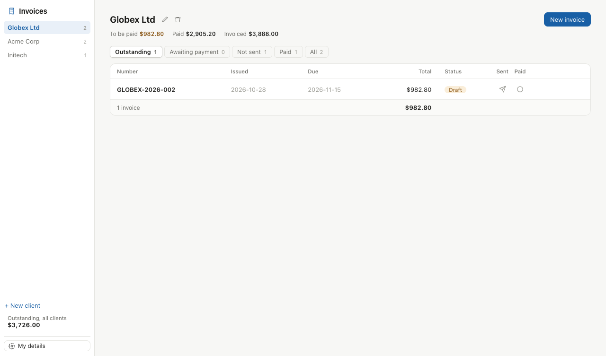

# Invoice Generator

A local invoice manager. Keep a client book, issue numbered invoices, track
sent and paid status, and print or download a PDF. Every invoice is a plain
JSON file on your disk under `~/.fused-render/data/invoice_generator/`.

- Per-client invoice numbering, line items, tax, discount and FX reference rates.
- Attach PDFs or images. They print as extra A4 pages after the invoice.
- Pure-stdlib Python backend (`invoice.py`), so there's nothing to install.
- `tools.py` and `mcp.toml` expose the same backend as MCP tools via
  `fused app serve <this folder>`.

> The first time you attach a PDF, the app fetches pdf.js from
> `cdn.jsdelivr.net` to render it. Your file is never uploaded.
